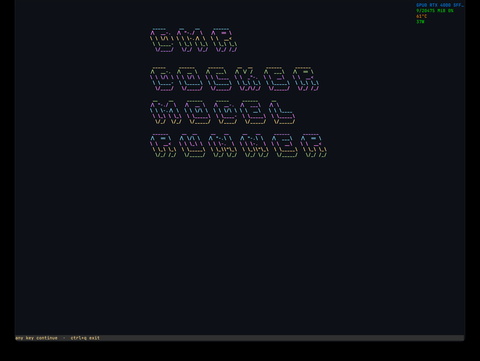
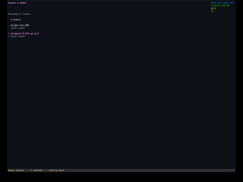
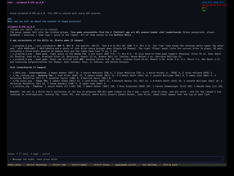
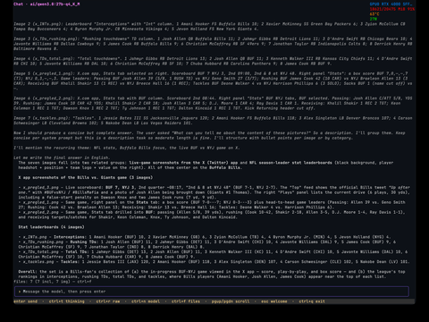

# ssh-llm-tui

SSH terminal chat for local models served by [Docker Model Runner](https://docs.docker.com/ai/model-runner/) (DMR). Connect with `ssh -p 2222 user@host` and you get this app instead of a shell.

Version 1.1.1. The interface is a terminal UI, built with Go and the Charm stack (Wish, Bubble Tea, Lip Gloss, Bubbles). Released under the MIT license. See [LICENSE](LICENSE) and [CHANGELOG.md](CHANGELOG.md).

The container talks to DMR only over HTTP. It does not mount the Docker socket and it does not call the `docker` CLI, so it cannot pull models or start containers.

## Screenshots

Click a thumbnail to open the full-size image.

<table>
  <tr>
    <td align="center" width="50%">
      <a href="docs/screenshots/01-welcome.png"></a><br>
      <sub><b>1. Welcome screen.</b> The banner comes from a mounted <code>welcome/banner.txt</code>. The GPU panel in the top right shows VRAM, temperature and power draw.</sub>
    </td>
    <td align="center" width="50%">
      <a href="docs/screenshots/02-model-picker.png"></a><br>
      <sub><b>2. Model picker.</b> Lists the models already pulled in Docker Model Runner. Going back to this screen unloads the previous model.</sub>
    </td>
  </tr>
  <tr>
    <td align="center" width="50%">
      <a href="docs/screenshots/03-chat-vision.png"></a><br>
      <sub><b>3. Chat with images.</b> Seven screenshots uploaded over SCP and described by a vision model, with Markdown rendering and the reasoning collapsed.</sub>
    </td>
    <td align="center" width="50%">
      <a href="docs/screenshots/04-chat-reasoning.png"></a><br>
      <sub><b>4. Reasoning expanded.</b> <code>Ctrl+T</code> shows the model's thinking above the final answer.</sub>
    </td>
  </tr>
</table>

## Requirements

- Docker Engine with Compose.
- Docker Model Runner already running on the host, with its API port **12434** published on `127.0.0.1` and on the docker0 gateway (`172.17.0.1` on a typical bridge).
- Models already pulled on the host. This app only lists and runs them:

  ```bash
  docker model pull ai/gpt-oss:20b
  docker model ls
  ```

- For the GPU panel, the NVIDIA container toolkit on the host. Stats use `NVIDIA_DRIVER_CAPABILITIES=utility`. Inference stays with DMR.
- Nothing in the compose file starts a second model runner.

From another container, `127.0.0.1:12434` is the container itself. Compose maps `host.docker.internal` to `host-gateway`, and the app uses `http://host.docker.internal:12434`.

## Tested with

Tested with Docker Engine 29.x, an NVIDIA RTX GPU, and Docker Model Runner (llama.cpp backend). The client follows the DMR v1.2.9 HTTP API (`/engines` prefix).

`go test ./...`, `go vet ./...`, and `go test -race ./...` cover the model list, warm, unload, streaming chat, uploads, the GPU panel, Markdown rendering, the GGUF header reader, the memory estimate and the configure calls.

## Quick start

```bash
docker compose build
docker compose up -d
ssh -p 2222 user@<host>
```

Any username is accepted. With the default `AUTH_MODE=open` there is no password and no key. OpenSSH completes the initial `none` authentication and drops you into the TUI. Your own shell comes back when you exit.

Screens:

1. Welcome. The copy comes from the mounted YAML, or from `welcome/banner.txt` when that art fits. Press a key.
2. Model list. Names are shown without a `docker.io/` prefix (`ai/gpt-oss:20b`). Requests to DMR still use the full id.
3. Context size (8k to 128k, capped by the model's trained context), then where to run it: all GPUs, one GPU, or the CPU. Each choice shows the estimated memory and whether it fits.
4. Memory check. The estimate per GPU (or RAM), the free memory and the verdict. A model that does not fit is not loaded; the screen offers the largest context that fits, the CPU, or another model.
5. The app sends the chosen settings to DMR (the same call as `docker model configure`), warms the model, then opens the chat.
6. Chat. Replies stream token by token. History stays in the SSH session.

If DMR returns an empty list, the model screen says so and tells you to pull a model on the Docker host, then press `r`.

A help bar sits on the last row of every screen. It wraps or shortens on a narrow terminal, and it is part of the layout so it cannot scroll off.

## Keys

| Key | Where | Action |
| --- | --- | --- |
| any key except esc | welcome | continue |
| esc | welcome, model list, loading | nothing (on the model list, esc still clears a filter) |
| esc | chat | unload models if this is the only session, then return to welcome. The SSH session stays open |
| enter | model list / chat | select a model, or send a line |
| ↑/↓, `j`/`k`, enter, esc | context and target pickers | choose, continue, go back |
| enter | memory check | load (only when it fits, or after `y`) |
| `y` | memory check | load a model whose memory need is unknown |
| `s` / `p` / `u` / `m` | memory check | use the largest context that fits / run on CPU / unload idle models and check again / back to the model list |
| `ctrl+o` | chat | change context size or GPU/CPU for the current model |
| `r` | model list | refresh |
| `ctrl+t` | chat | expand or collapse the latest reasoning block |
| `ctrl+r` | chat | switch assistant replies between rendered Markdown and raw text |
| `ctrl+n` | chat | unload runners and pick another model, even if other sessions are connected |
| `ctrl+f` | chat | focus the file box. `j`/`k` and pgup/pgdn scroll it, space includes, `d` deletes one, `D` clears all after y/n, `esc` leaves the box |
| `ctrl+c` | chat | cancel the reply in progress. It does not exit |
| `pgup` / `pgdn`, `ctrl+u` / `ctrl+d` | chat | scroll |
| `ctrl+q` | every screen | unload if this is the last session, then close SSH |

Closing the session, or the connection dropping, unloads every DMR runner when this was the last TUI session. SCP and SFTP are not counted. See Shared GPU.

The window can be resized. Finished assistant replies are rendered again at the new width.

## Configuration

`config.example.yaml` is the baked-in default and the file compose mounts at `/config/config.yaml`. Environment variables override the file. An empty variable does not override.

| Variable | Default | Purpose |
| --- | --- | --- |
| `SSH_HOST` | `0.0.0.0` | listen address |
| `SSH_PORT` | `2222` | listen port |
| `HOST_KEY_PATH` | `/data/hostkeys/ssh_host_ed25519_key` | persisted server host key |
| `AUTH_MODE` | `open` | `open` or `keys` |
| `AUTHORIZED_KEYS_PATH` | empty | required when `AUTH_MODE=keys` |
| `CONFIG_PATH` | `/config/config.yaml` | YAML file. A missing path is an error when this is set |
| `DMR_BASE_URL` | `http://host.docker.internal:12434` | DMR origin |
| `DMR_REQUEST_TIMEOUT` | `60s` | chat and list timeout |
| `DMR_WARM_TIMEOUT` | `10m` | model warm timeout |
| `WELCOME_TITLE` | `ssh-llm-tui` | welcome title when the banner is not shown |
| `WELCOME_MESSAGE` | see YAML | welcome text when the banner is not shown |
| `WELCOME_HINT` | press any key | line under the welcome text |
| `WELCOME_BANNER_FILE` | empty in YAML, `/config/welcome/banner.txt` in compose | ASCII art, read on every welcome screen |
| `MODELS_TITLE`, `MODELS_EMPTY`, `MODELS_HINT`, `MODELS_LOADING` | see YAML | model list copy |
| `LOADING_TITLE`, `LOADING_MESSAGE` | see YAML | warm screen. `{model}` is replaced with the friendly name |
| `CHAT_TITLE`, `CHAT_PLACEHOLDER`, `SYSTEM_PROMPT`, `CHAT_YOU_LABEL` | see YAML | chat copy and the system prompt |
| `MARKDOWN` | `on` | `on` renders finished assistant replies. `off` leaves them plain. `ctrl+r` toggles the session |
| `FOOTER_CHANGE`, `FOOTER_EXIT`, `FOOTER_SCROLL` | see YAML | accepted and ignored. The help bar is drawn by the app |
| `UPLOAD_DIR` | `/uploads` | on-disk root. Files live in `/uploads/<user>/` |
| `UPLOAD_MAX_BYTES` | `10485760` | per file |
| `UPLOAD_MAX_FILES` | `10` | per username |
| `CONTEXT_TOKEN_BUDGET` | `8192` | rough byte/4 cap for included text. Once a context size is chosen, the cap is three quarters of it |
| `IMAGE_MAX_PX` | `1536` | longest side after downscale |
| `IMAGE_MAX_BYTES` | `2097152` | encoded image payload cap |
| `FILES_BOX_ROWS` | `4` | file rows when the box is focused |
| `VISION_MODELS` | empty | comma-separated globs that force an image attempt |
| `NON_VISION_MODELS` | empty | comma-separated globs that skip images |
| `GPU_STATS` | `auto` | `auto` or `off` |
| `GPU_POLL_INTERVAL` | `2s` | nvidia-smi poll |
| `NVIDIA_SMI` | `nvidia-smi` | path to the binary |
| `GPU_TEMP_WARN`, `GPU_TEMP_HOT`, `GPU_TEMP_CRIT` | `40`, `60`, `70` | °C colour bands |
| `GPU_POWER_WARN`, `GPU_POWER_HOT`, `GPU_POWER_CRIT` | `25`, `100`, `200` | watt colour bands |
| `GPU_MEM_WARN`, `GPU_MEM_HOT`, `GPU_MEM_CRIT` | `40`, `60`, `90` | VRAM percent colour bands |
| `FIT_CHECK` | `on` | `on`: refuse a model that does not fit and ask before loading one of unknown size. `strict`: refuse unknown sizes too. `off`: no check |
| `FIT_MARGIN_MIB`, `FIT_MARGIN_PCT` | `1024`, `5` | headroom kept free per GPU (and in RAM): the larger of the two |
| `CONTEXT_CHOICES` | `8k,16k,32k,64k,128k` | sizes offered by the context picker |
| `DEFAULT_CONTEXT` | `auto` | preselected size. `auto` is the largest that fits |
| `CONTEXT_SELECT`, `TARGET_SELECT` | `on` | show the context and GPU/CPU pickers |
| `ALLOW_CPU` | `on` | offer the CPU (system RAM) target |
| `MODEL_STORE_PATH` | empty, `/dmr-models` in compose | read-only mount of the DMR model store, used to read GGUF headers |
| `KV_CACHE_TYPE` | empty (f16) | optional llama.cpp KV cache type, e.g. `q8_0`, sent as `--cache-type-k/v` |
| `CPU_THREADS` | `0` | llama.cpp threads for the CPU target. `0` keeps the default |
| `FIT_USAGE_PATH` | `/data/fit/usage.json` | measured GPU usage per model, context and target. `off` keeps it in memory |

With `FIT_CHECK=off`, `CONTEXT_SELECT=off`, `TARGET_SELECT=off` and no `KV_CACHE_TYPE`, model selection works as in 1.0.x: warm only, no configuration call.

Warm, chat, and unload calls send the full model id from `GET /engines/v1/models`. The screen shows the name without a `docker.io/` prefix.

### DMR base URL

```yaml
extra_hosts:
  - "host.docker.internal:host-gateway"
  - "model-runner.docker.internal:host-gateway"
```

| From | URL |
| --- | --- |
| this container (default) | `http://host.docker.internal:12434` |
| same container, bridge IP directly | `http://172.17.0.1:12434` |
| the Docker host | `http://127.0.0.1:12434` |

`model-runner.docker.internal` without a port is the Docker Desktop name. On Docker Engine the port is 12434, so use `http://model-runner.docker.internal:12434` if you prefer that hostname. Do not point the container at `127.0.0.1:12434`.

## Auth and the host key

`AUTH_MODE=open` is for a trusted LAN. Anyone who can open TCP 2222 gets a session that can load models and use the GPU. Key auth is the setup to use once the port is reachable beyond that LAN.

For key auth, set `AUTH_MODE=keys`, mount an `authorized_keys` file, and set `AUTHORIZED_KEYS_PATH`. Any username is still accepted. The key has to be in that file. Do not commit the file.

The server host key is written to the `ssh-llm-tui-hostkeys` volume (`/data/hostkeys/ssh_host_ed25519_key`) so clients do not see a host-key change on every restart. The process runs as uid 65532. A new named volume picks up that ownership from the image. A bind mount must be writable by uid 65532:

```bash
mkdir -p data/hostkeys
sudo chown 65532:65532 data/hostkeys
```

## Welcome banner

`welcome/banner.txt` is mounted at `/config/welcome/banner.txt`. The welcome screen reads that file every time it is drawn, so edit the art and reconnect. The art is centered and coloured. Inner spaces are kept. Trailing blank lines are dropped. When the file is present and the art fits, the welcome screen shows that art, with the GPU panel at the top when stats are available. The title and `WELCOME_MESSAGE` are used when the file is missing, empty, or wider than the terminal. Compose leaves `WELCOME_MESSAGE` commented so a session with `banner.txt` stays on the art.

The compose file mounts the `welcome/` directory, not the single file. Editors that replace the inode (`vim` with `backupcopy=no`, `sed -i`) break a single-file bind mount. Inside the directory they are fine. If you mount the file itself, set `:set backupcopy=yes` in vim.

## Uploads

SCP and SFTP listen on the same port and use the same auth as the TUI.

```bash
scp -P 2222 notes.txt user@host:uploads/
sftp -P 2222 user@host
```

`host:` (the remote root) and `host:uploads/name` land in the same per-user directory. Nothing outside that directory is writable.

FileZilla and WinSCP work over SFTP to port 2222. Plain text, Markdown, source, CSV, JSON, YAML, and logs are included as UTF-8. DOCX text is read from `word/document.xml`. PDF text is extracted with a pure-Go reader. A scanned PDF has no text layer, so the box shows that nothing could be extracted. There is no OCR.

On the chat screen the file list is a full-width strip just above the input. Unfocused it is one line, `files: 7 (3 incl, 2 img) — ctrl+f`. `ctrl+f` expands it to `FILES_BOX_ROWS` (default 4) single-line rows. A long name is cut with `…` and does not wrap. `j`/`k`, arrows, pgup, and pgdn scroll the list. `esc` or `ctrl+f` leaves the list. Space toggles include, `d` removes one file, `D` clears every file after a y/n confirm. The `scp` hint sits on the title line of the open box.

PNG, JPEG, WebP, and GIF (first frame) are detected by magic bytes. They are scaled so the long side is at most `IMAGE_MAX_PX` (default 1536) and re-encoded under `IMAGE_MAX_BYTES` (default 2MiB). The row shows `img` and the sent dimensions, for example `img 1920x1080  307 KiB`. Text files still show size and `~Nt`.

Included images go out once, on the next user message, as OpenAI content parts (`image_url` data URLs) on `POST /engines/v1/chat/completions`. Text-only messages stay a JSON string. Later turns do not send the base64 again. The row says `sent`. Include the file again to send it on a later message. The prompt also lists attached names. Text bodies stay under `CONTEXT_TOKEN_BUDGET` (default 8192).

DMR's model list does not say whether a model can see images. This app still tries. If the backend returns an HTTP error that mentions images, vision, multimodal, or mmproj, the chat shows `This model does not accept images (no vision/mmproj). Text was sent without images.` and resends that message as text. The session remembers that model. `NON_VISION_MODELS` (comma-separated globs) skips the image attempt. `VISION_MODELS` forces the attempt.

llama.cpp accepts images when that model was loaded with an mmproj (a vision projector). `docker model inspect <model>` is the check: look for an mmproj file, a vision projector, or a VL / vision tag. A text quant such as `ai/qwen3.8:27b-q4_K_M` needs that projector in the model card. `ai/gpt-oss:20b` is a text model. vLLM vision models use the same `/engines/v1` path when DMR routes them there.

Bytes are stored under `UPLOAD_DIR` (default `/uploads/<user>/`), which compose mounts as a tmpfs. The directory is emptied when the process starts and when that user's last TUI session ends.

## GPU panel

Every screen keeps a GPU panel in the top-right. One poller serves every session (`GPU_POLL_INTERVAL`, default 2s). `GPU_STATS=off` hides it. If `nvidia-smi` is missing, the line is `GPU n/a` and chat still works.

Each GPU is a column of four rows: the name in the terminal's default text colour, VRAM used/total and percent, temperature, and power. A model loaded on that GPU (`nvidia-smi` compute memory) makes the name bold and adds `*`. Those GPUs are drawn first. Several GPUs sit side by side. If they do not fit on one row, the columns wrap onto a second block. Narrower terminals use one coloured line per GPU.

| | green | yellow | orange | red |
| --- | --- | --- | --- | --- |
| Temperature | < 50°C | 50–60 | 60–70 | ≥ 70 |
| Power | < 50W | 50–75 | 75–150 | ≥ 150 |
| VRAM used | < 25% | 25–50 | 50–75 | ≥ 75 |

`50–60` means 50 ≤ t < 60, and the same pattern for the other open ends. The VRAM row looks like `18583/20475 MiB 91%`. nvidia-smi temperature can be a fraction (`60.06`). The panel rounds the number and colours the raw value.

The runtime image is Debian (glibc) so the NVIDIA toolkit can inject `nvidia-smi`. `utility` is statistics only. It does not take the GPU away from Docker Model Runner. After changing compose, recreate the container.

## Markdown

Finished assistant replies are rendered as Markdown (headings, emphasis, lists, tables, links, and highlighted code) with a fixed dark style, wrapped to the chat width. The renderer does not query the terminal background, so it is safe over SSH. `MARKDOWN=off` leaves replies as plain text. `ctrl+r` switches the session. A reply that is still streaming stays plain text, then renders once it finishes. User messages and the collapsed thinking block stay plain. A wide table is wrapped, and any line that is still wider than the viewport is clipped.

## Reasoning

Reasoning stays collapsed. While the model is thinking, the transcript shows `▸ Thinking…` with a spinner and elapsed time. After the reply, it shows `▸ Thought for Ns`. `ctrl+t` expands or collapses the latest block. Each message keeps its own state. Expanded text is dimmed.

That covers `delta.reasoning` and `delta.reasoning_content` (models such as gpt-oss) and `<think>...</think>` tags inside the answer text (models such as Qwen), including a tag split across stream chunks. Reasoning is not sent back on the next turn. A null or non-string reasoning field is ignored.

## Shared GPU

Every SSH session shares one GPU. Warming or unloading takes a process-wide lock so two sessions do not load and unload at the same time. Chat requests themselves are not locked.

`ctrl+n` asks DMR to unload all runners, then returns to the model list. That affects every connected session. DMR will not unload a runner that is inside a request. A reply that is still streaming in another session keeps its runner until it finishes.

`ctrl+q` and a dropped connection remove the TUI session. Only if the count is now zero does the process call `POST /engines/unload` with `{"all":true}` in the background, with a 15s timeout and the same GPU lock. If another session connects while unload is waiting for the lock, the unload is skipped and that is logged.

`esc` on the chat screen stays connected. If this is the only TUI session it unloads, then returns to the welcome screen. If someone else is still in the app it skips the unload and still returns to welcome.

## Memory check

Before a model loads, the app estimates how much memory it needs and compares that with what is free right now (`nvidia-smi` `memory.free` per GPU, `MemAvailable` for the CPU target).

Estimate:

- Weights: the tensor data size from the GGUF header (all shards). The token embedding table stays in system RAM (llama.cpp never offloads it), so it counts only for the CPU target. A vision projector is added on the first GPU.
- KV cache: `2 × Σ layers (KV heads × head dim) × context × 2 bytes` (f16). Sliding-window layers (Gemma, gpt-oss) only keep the window plus one batch. Layers without attention (hybrid and recurrent models) keep none.
- Recurrent state for hybrid models (linear-attention / SSM layers), from the `ssm.*` header keys, for each of DMR's 4 parallel slots.
- Compute buffer and a per-GPU runtime overhead of about 256 MiB.
- Plus 3 % for error. Measured against real loads, estimates land roughly 2–5 % above actual GPU usage.

Placement:

- Auto spreads layers over every GPU in proportion to free memory, which is llama.cpp's default. Each GPU must fit its own share, its compute buffer and the headroom. Enough memory in total is not enough.
- A single GPU sends `--device CUDA<n>`. CPU sends `--device none`, so nothing is offloaded.
- Changing the settings of a model that is loaded and idle makes DMR stop its runner before starting the new one. The memory that runner holds (as estimated, capped at what the GPU reports in use) counts as free for that check, so the model does not compete with itself.
- Headroom is `max(FIT_MARGIN_MIB, FIT_MARGIN_PCT % of the device)`. Using part of it is reported as tight and still allowed. Exceeding free memory is refused.

Where the numbers come from:

1. GGUF headers from a read-only mount of DMR's model store (`MODEL_STORE_PATH`). Only the first megabytes of each model file are read.
2. Without the mount, GPU memory measured after an earlier successful load of the same model, context and target (`FIT_USAGE_PATH`).
3. With neither, the size is unknown. The check says so and loads only after `y`, or never with `FIT_CHECK=strict`.

DMR does not report model sizes or GGUF metadata over its API (v1.2.9), so the mount is what makes the check exact. On Docker Engine, DMR keeps models in the volume `docker-model-runner-models`. Compose mounts it read-only:

```yaml
    environment:
      MODEL_STORE_PATH: /dmr-models
    volumes:
      - dmr-models:/dmr-models:ro

volumes:
  dmr-models:
    external: true
    name: docker-model-runner-models
```

Check the name with `docker volume ls`. If DMR does not keep models in a Docker volume (Docker Desktop, for example), remove the mount, the volume entry and `MODEL_STORE_PATH`. The check then relies on measured usage. The mount is read-only and contains only model files. It gives no access to Docker.

Settings go to DMR as `POST /engines/_configure`, the same API as `docker model configure`. The check screen shows the equivalent command, for example:

```bash
docker model configure --context-size 32768 ai/gpt-oss:20b -- --device none
```

DMR keeps one configuration per model for all sessions, and forgets it when it restarts. The app sends it again before every load. If another session is in the middle of a reply on the same model, DMR refuses the change (HTTP 409), and the app says so instead of loading.

The estimate is an estimate. Another process can take GPU memory between the check and the load, and some architectures allocate more than the formula expects. The headroom absorbs small errors.

## DMR HTTP API

Written against DMR v1.2.9, whose routes use the prefix `/engines`. Reference: [DMR REST API](https://docs.docker.com/ai/model-runner/api-reference/). Some third-party pages still say `/inference/unload`. That path does not match v1.2.9.

| What | Request |
| --- | --- |
| List pulled models | `GET /engines/v1/models` |
| Warm into GPU memory | `POST /engines/v1/chat/completions` with header `X-Preload-Only: true` and body `{"model":"<full id>","messages":[]}` |
| Stream a reply | `POST /engines/v1/chat/completions` with `"stream": true` |
| Unload all runners | `POST /engines/unload` with `{"all":true}` |
| Set context size and runtime flags | `POST /engines/_configure` with `{"model":"<full id>","context-size":32768,"runtime-flags":["--device","CUDA1"]}`. 202 on success, 409 when the model is busy |
| Read configurations | `GET /engines/_configure?model=<full id>` |
| Running runners | `GET /engines/ps` |

`POST /models/load` imports a model tar in v1.2.9. This app does not call it.

A model list entry looks like `docker.io/ai/gpt-oss:20b` with an empty `dmr` object. The list does not report vision support. An empty `data` array means no models are pulled.

## Security

- `AUTH_MODE=open` belongs on a trusted LAN. Do not publish port 2222 on the public internet in open mode. Use `AUTH_MODE=keys` beyond that LAN.
- No Docker socket, no `docker` CLI, and no shell in the session. Context size and GPU/CPU placement use DMR's HTTP API, whose runtime flags DMR checks against its own allowlist.
- The optional model store mount is read-only. The app only reads GGUF headers and the store index from it.
- Chat text is sent only to DMR. The server log records connections and model ids, not message bodies.
- The image runs as non-root (uid 65532), read-only, with all capabilities dropped and `no-new-privileges`.
- Do not commit host keys or `authorized_keys`.

## Limitations

- Unload skips runners that are mid-request. `ctrl+n` cannot free the GPU out from under another session's in-flight reply.
- Cancelling a warm (by leaving the session) aborts the HTTP wait. DMR may still finish loading the runner it already started.
- Concurrent chats share whatever is currently loaded.
- The app does not pull or delete models. It configures context size and placement per model, but it does not reinstall the runner (`docker model reinstall-runner --gpu`). Switching the whole runner between CUDA and CPU images needs the Docker API, so it stays a host task.
- GPU indexes in the target picker follow `nvidia-smi`. llama.cpp names devices in CUDA order (`CUDA0`, `CUDA1`). On hosts with different GPU models the two orders can differ unless DMR runs with `CUDA_DEVICE_ORDER=PCI_BUS_ID`.

## Develop

```bash
go test ./...
go vet ./...
go test -race ./...
docker build -t ssh-llm-tui:1.1.1 .
```

Go 1.24 or newer. The module downloads a newer toolchain if the system Go is older.
